# Two-Tier Flask App: CI/CD Pipeline on AWS EC2

A two-tier web application (**Flask** + **MySQL**) deployed on an **AWS EC2** instance through a fully automated CI/CD pipeline built with **Jenkins**, **Docker** and **Docker Compose**. A push to GitHub results in a fresh build and deployment, with no manual steps on the server.

---

## Table of contents

1. [Architecture](#architecture)
2. [Tech stack](#tech-stack)
3. [Prerequisites](#prerequisites)
4. [Step 1: Launch the EC2 instance](#step-1-launch-the-ec2-instance)
5. [Step 2: Connect with SSH](#step-2-connect-with-ssh)
6. [Step 3: Prepare the server](#step-3-prepare-the-server)
7. [Step 4: Install Docker and Docker Compose](#step-4-install-docker-and-docker-compose)
8. [Step 5: Install Java and Jenkins](#step-5-install-java-and-jenkins)
90. [Step 6: First-time Jenkins setup](#step-6-first-time-jenkins-setup)
10. [Step 7: Create the pipeline job](#step-7-create-the-pipeline-job)
11. [Step 8: Verify the deployment](#step-8-verify-the-deployment)
12. [Stopping, restarting and cleaning up](#stopping-restarting-and-cleaning-up)
13. [Troubleshooting](#troubleshooting)
14. [Screenshots](#screenshots)
15. [Credits](#credits)

---

## Architecture

```
 Developer          GitHub                  AWS EC2 (Ubuntu 26.04)
 +----------+ push  +------+  clone   +--------------------------------+
 | git push | ----> | Repo | <------- | Jenkins (port 8080)            |
 +----------+       +------+          |  1. Clone code                 |
                                      |  2. docker build               |
                                      |  3. docker compose up -d       |
                                      |    +-----------+  +--------+   |
 Browser ------- http://<ip>:5000 --> |    | Flask app |->| MySQL  |   |
                                      |    +-----------+  +--------+   |
                                      +--------------------------------+
```

| Port | Purpose | Allowed source |
|------|---------|----------------|
| 22 | SSH | Your IP only |
| 8080 | Jenkins dashboard | Your IP only (Anywhere if you use a GitHub webhook) |
| 5000 | Flask application | Anywhere (0.0.0.0/0) |
| 80 | HTTP (optional) | Anywhere |

## Tech stack

| Layer | Tool |
|-------|------|
| Cloud | AWS EC2, EBS, Security Groups |
| OS | Ubuntu Server 26.04 LTS |
| CI/CD | Jenkins (LTS), GitHub |
| Containers | Docker, Docker Compose |
| App | Python Flask |
| Database | MySQL 8 |

## Prerequisites

- An AWS account (set a billing alert first under Billing > Budgets)
- A GitHub account and a **public** fork of this repository
- Git and a terminal on your laptop
- Roughly 2 to 3 hours

---

## Step 1: Launch the EC2 instance

1. In the AWS Console, pick a region (for example **Asia Pacific (Mumbai) ap-south-1**) and open **EC2 > Launch instance**.
2. Configure:

   | Setting | Value |
   |---------|-------|
   | Name | `two-tier-flask-jenkins` |
   | AMI | Ubuntu Server 26.04 LTS (HVM, SSD Volume Type), 64-bit x86 |
   | Instance type | `t3.small` recommended (2 GB RAM). `t2.micro` / `t3.micro` (1 GB) works only with swap and is slow |
   | Key pair | Create new, RSA, `.pem` format. Store it safely: AWS will not let you download it again |
   | Storage | **20 to 30 GiB gp3** (the 8 GiB default fills up) |
   | Public IP | Auto-assign enabled |
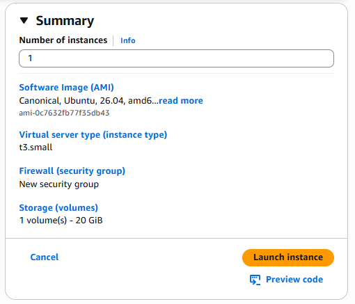

3. Create a security group with these inbound rules:

   | Type | Port | Source |
   |------|------|--------|
   | SSH | 22 | My IP |
   | HTTP | 80 | Anywhere |
   | Custom TCP | 5000 | Anywhere |
   | Custom TCP | 8080 | My IP |
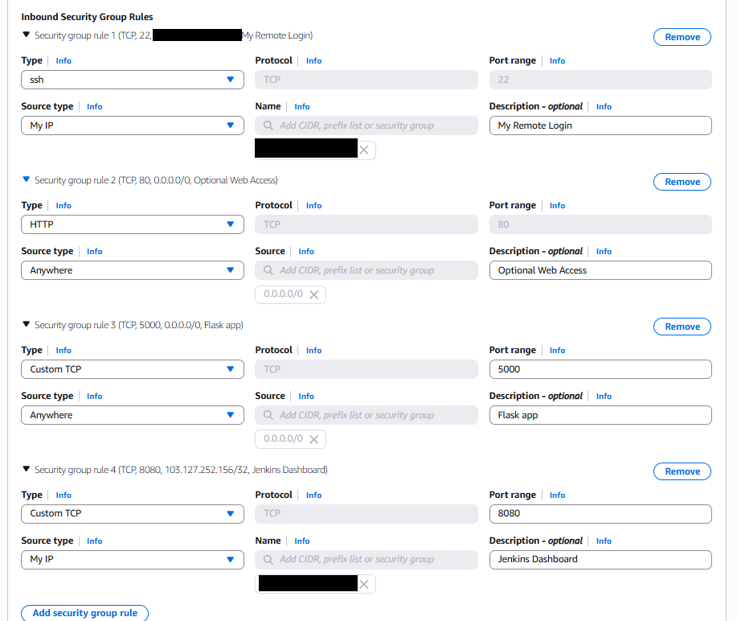

4. Click **Launch instance**. Wait for **Running** and **2/2 checks passed**, then copy the **Public IPv4 address**.
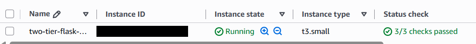

> The public IP changes every time you stop and start the instance.

## Step 2: Connect with SSH

**Windows** (Command Prompt). First fix the key permissions, otherwise SSH rejects the key:

```cmd
set KEY=D:\path\to\your-key.pem
icacls "%KEY%" /inheritance:r
icacls "%KEY%" /grant:r "%USERNAME%:R"
icacls "%KEY%" /remove "NT AUTHORITY\Authenticated Users"
icacls "%KEY%" /remove "BUILTIN\Users"
icacls "%KEY%"
ssh -i "%KEY%" ubuntu@<public-ip>
```

**Mac / Linux:**

```bash
chmod 400 ~/Downloads/your-key.pem
ssh -i ~/Downloads/your-key.pem ubuntu@<public-ip>
```

The username is always `ubuntu`. Replace `<public-ip>` with the real address and drop the angle brackets. As a backup you can use **Connect > EC2 Instance Connect** in the console.
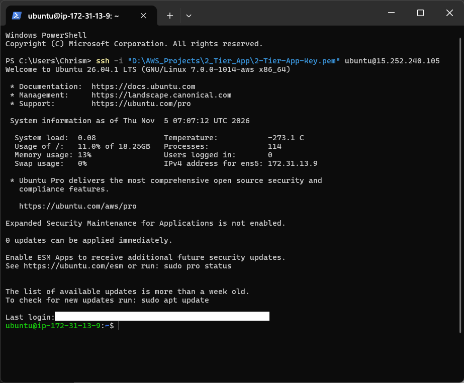

## Step 3: Prepare the server

### Add swap (do this before installing anything)

```bash
sudo fallocate -l 2G /swapfile
sudo chmod 600 /swapfile
sudo mkswap /swapfile
sudo swapon /swapfile
echo '/swapfile none swap sw 0 0' | sudo tee -a /etc/fstab
free -h
```

The Swap row should show about 2.0Gi. Jenkins takes its worker node offline when swap is 0.

### Update and check disk space

```bash
sudo apt update && sudo apt upgrade -y
df -h /
```

You want roughly 10 GB or more free. If the root disk is only about 6.7 GB, resize it (see [T12](#troubleshooting)).

### Optional: keep `/tmp` out of RAM

On a small instance `/tmp` is a RAM-backed filesystem of about 450 MB, which triggers a Jenkins temp-space warning. Move it to disk:

```bash
sudo systemctl mask tmp.mount
sudo reboot
```

Reconnect afterwards (the IP stays the same on a reboot). Or skip this and lower the Jenkins threshold in Step 6.
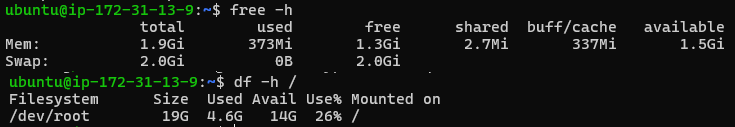

## Step 4: Install Docker and Docker Compose

```bash
sudo apt install git docker.io docker-compose-v2 -y
sudo systemctl enable --now docker
sudo usermod -aG docker $USER
newgrp docker
docker --version
docker compose version
docker ps
```
(screenshots/S08-docker-versions.png)

Type `$USER` exactly as written; the shell fills it in (it becomes `ubuntu`). `docker ps` should print an empty table without a permission error.

## Step 5: Install Java and Jenkins

Install Java first, because Jenkins may fail to start without it:

```bash
sudo apt install fontconfig openjdk-21-jre -y
java -version
```

Clean up any earlier failed attempt, then add the **2026** Jenkins key and the LTS repository:

```bash
sudo rm -f /etc/apt/sources.list.d/jenkins.list /usr/share/keyrings/jenkins-keyring.asc

KEY=/etc/apt/keyrings/jenkins-keyring.asc
sudo wget -O $KEY https://pkg.jenkins.io/debian-stable/jenkins.io-2026.key

echo "deb [signed-by=$KEY] https://pkg.jenkins.io/debian-stable binary/" | \
  sudo tee /etc/apt/sources.list.d/jenkins.list > /dev/null
```

Run these in the same terminal session (`KEY` is a temporary shell variable). Verify the repo file contains exactly one line:

```bash
cat /etc/apt/sources.list.d/jenkins.list
```

Install and start Jenkins, then let it use Docker:

```bash
sudo apt update
sudo apt install jenkins -y
sudo systemctl enable --now jenkins
sudo systemctl status jenkins

sudo usermod -aG docker jenkins
sudo systemctl restart jenkins
sudo -u jenkins docker ps
```

Look for `active (running)`. The last command must print an empty container table.
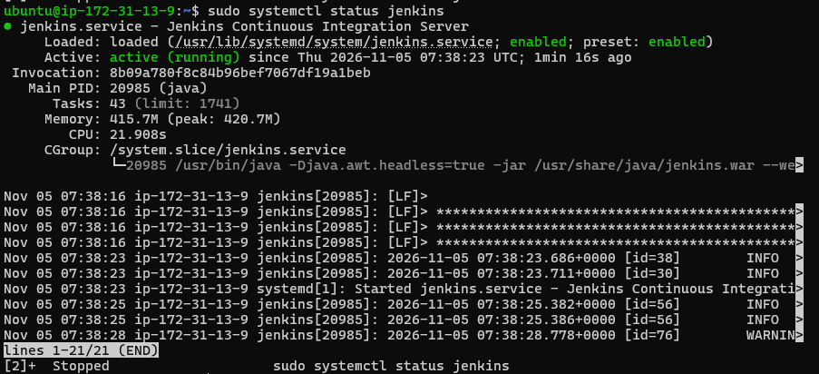

## Step 6: First-time Jenkins setup

1. Get the unlock password and open `http://<public-ip>:8080`:
   ```bash
   sudo cat /var/lib/jenkins/secrets/initialAdminPassword
   ```
2. Choose **Install suggested plugins**, create your admin user, and finish the wizard.
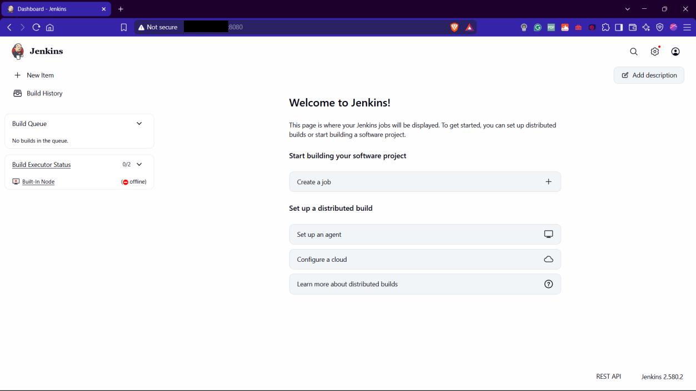
3. Go to **Manage Jenkins > Nodes** and confirm the **Built-In Node** is online (no red cross).
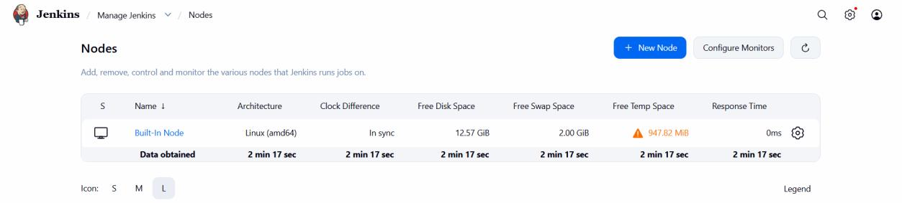
4. If you did not move `/tmp` in Step 3: on the Nodes page click the gear icon (**Configure Monitors**), set **Free Temp Space** to about `100` MB, and save.

## Step 7: Create the pipeline job

1. **New Item** > name `two-tier-flask` > **Pipeline** > OK.
2. Under **Pipeline** set:

   | Field | Value |
   |-------|-------|
   | Definition | Pipeline script from SCM |
   | SCM | Git |
   | Repository URL | `https://github.com/<your-username>/DevOps-Project-Two-Tier-Flask-App.git` |
   | Credentials | none (public repo) |
   | Branch Specifier | `*/main` |
   | Script Path | `Jenkinsfile` |
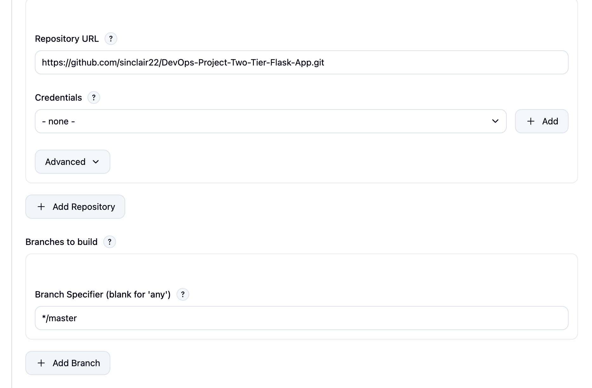

3. Click **Save**, then **Build Now**.
4. Open the build number > **Console Output**. The first build is slow because it pulls the Python and MySQL images (5 to 10 minutes on a small server).
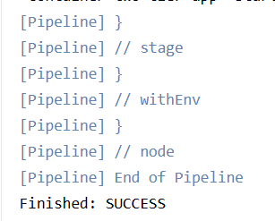

The pipeline has three stages: **Clone Code**, **Build Docker Image** and **Deploy with Docker Compose**. A successful run ends with `Finished: SUCCESS`.
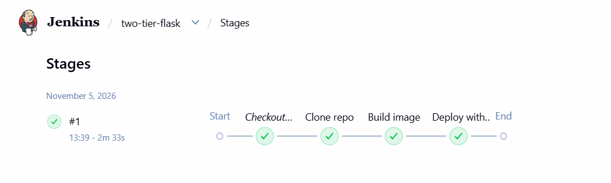

## Step 8: Verify the deployment

```bash
docker ps
docker logs two-tier-app
docker logs mysql
```
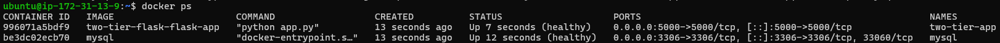

Both `mysql` and `two-tier-app` should be up, and show `(healthy)` after about a minute. Then open:

```
http://<public-ip>:5000
```

Submit a message and refresh the page. If it persists, the Flask-to-MySQL connection and the data volume are working.
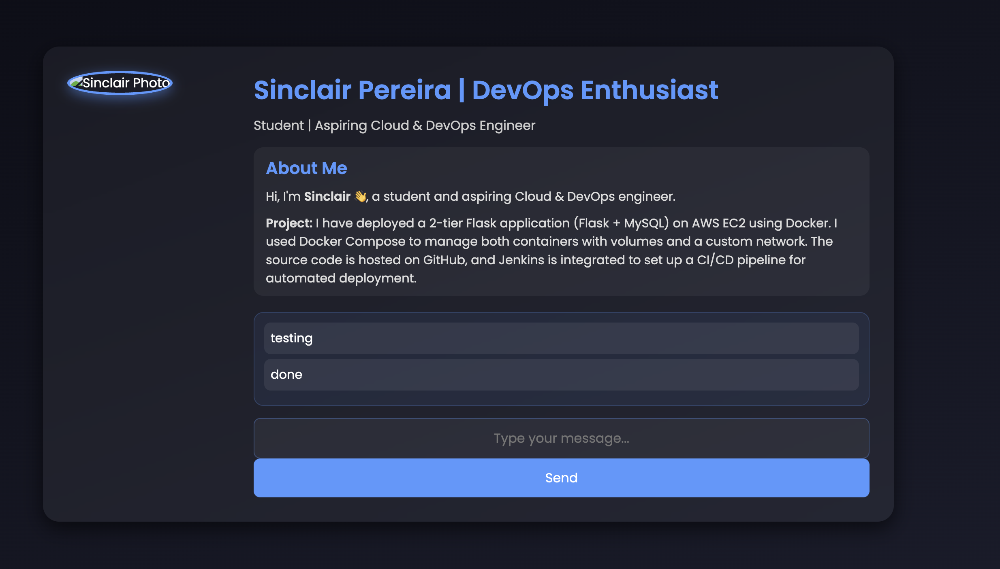
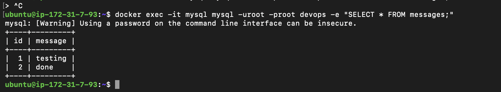

## Stopping, restarting and cleaning up

**Taking a break:**

```bash
sudo systemctl stop jenkins
cd /var/lib/jenkins/workspace/two-tier-flask
docker compose stop
```

Then **Stop** (not Terminate) the instance in the EC2 console.

**Coming back:**

1. Start the instance and copy the **new public IP**.
2. If your own IP changed, reset the SSH (22) and Jenkins (8080) rules to **My IP**.
3. SSH in and check `free -h`, `df -h /` and `sudo systemctl status jenkins`.
4. If needed: `sudo systemctl start jenkins`, then confirm the Jenkins node is online and run **Build Now**.

**When finished:** terminate the instance, release any Elastic IP, delete unused volumes and snapshots, and check Billing the next day.

---

## Troubleshooting

### Connecting

| Symptom | Cause | Fix |
|---------|-------|-----|
| `UNPROTECTED PRIVATE KEY FILE`, `Bad permissions` | Windows lets other users read the `.pem` | Run the `icacls` commands in Step 2. If the drive is not NTFS, copy the key to `C:\Users\<you>\.ssh\` and fix it there |
| `Connection timed out` | Your IP changed, or wrong IP | Set the SSH rule to **My IP** again and recopy the public IP |
| `Permission denied (publickey)` | Wrong user, key or instance | Use `ubuntu` and the key chosen at launch; try EC2 Instance Connect |

### Installing Jenkins

| Symptom | Cause | Fix |
|---------|-------|-----|
| `bash: syntax error near unexpected token '('` | Markdown link syntax pasted into the terminal | Copy from plain code blocks; URLs must have no brackets around them |
| `Package 'jenkins' has no installation candidate` | Repo not added, or the expired 2023 key was used | Remove the old list file, re-add the **2026** key and repo, then `sudo apt update` |
| `NO_PUBKEY` / not signed | Old key or duplicate repo entries | Delete old Jenkins entries in `/etc/apt/sources.list.d/` and redo Step 5 |
| Jenkins will not start | Java missing | Install `openjdk-21-jre`; check `sudo journalctl -u jenkins -n 50 --no-pager` |
| `docker-compose-v2` not found | Package name differs | `apt search docker-compose`, or install Docker from its official apt repo |

### Jenkins node offline or build stuck

| Symptom | Cause | Fix |
|---------|-------|-----|
| `Waiting for next available executor` | Built-In Node is offline | Open **Manage Jenkins > Nodes > Built-In Node**, read the reason and fix it, then **Bring this node back online** |
| Offline, `free -h` shows Swap `0B` | No swap | Create swap (Step 3), then restart Jenkins |
| `Disk space below threshold of 1.00 GiB` on `/var/lib/jenkins` (**T12**) | 8 GiB root disk, mostly used after swap | Enlarge the EBS volume (below) |
| `Disk space below threshold` on `/tmp` | `/tmp` is a RAM-based tmpfs, never 1 GiB free | Lower the Free Temp Space monitor, or `sudo systemctl mask tmp.mount` and reboot |

**T12: resize the disk.** In the EC2 console go to **Elastic Block Store > Volumes > Actions > Modify volume** and set 20 GiB. Then on the server:

```bash
lsblk
sudo growpart /dev/nvme0n1 1
sudo resize2fs /dev/nvme0n1p1
df -h /
```

Use the device and partition names shown by `lsblk` for the partition mounted at `/`. If `growpart` is missing, run `sudo apt install cloud-guest-utils`. For an XFS filesystem use `sudo xfs_growfs /`.

### Pipeline and build failures

| Symptom | Cause | Fix |
|---------|-------|-----|
| `couldn't find remote ref refs/heads/master` | Branch Specifier defaults to `*/master` | Set it to `*/main`, and use `branch: 'main'` in the Jenkinsfile |
| `Failed to connect to repository` | Wrong URL or private repo | Fix the URL, or make the repo public / add credentials |
| `permission denied ... /var/run/docker.sock` | Jenkins not in the `docker` group, or not restarted | `sudo usermod -aG docker jenkins`, `sudo systemctl restart jenkins`, test with `sudo -u jenkins docker ps` |
| `requirements.txt: not found` | Filename mismatch | Make the file name and Dockerfile `COPY` line identical, push, rebuild |
| `no space left on device` | Disk full | `docker system prune -f`, `sudo apt clean`, or enlarge the volume |
| Build killed, server freezes | Out of memory | Make sure swap exists; consider a `t3.small` |
| `docker compose: command not found` | Compose plugin missing | `sudo apt install docker-compose-v2 -y` |

### Application

| Symptom | Cause | Fix |
|---------|-------|-----|
| Container `(unhealthy)` | `/health` route or `curl` missing | Add both (see Repository fixes), push, rebuild |
| Port 5000 does not load | Port closed, container down, or IP changed | Check the security group, `docker ps`, `docker logs two-tier-app` |
| Flask restarts, cannot reach MySQL | MySQL not ready yet | Use `depends_on` with `condition: service_healthy`; wait a minute |
| Messages vanish after a rebuild | Data volume deleted | Never run `docker compose down -v`; check `docker volume ls` |

### Useful commands

```bash
free -h                         # memory and swap
df -h /                         # disk space
sudo systemctl status jenkins   # Jenkins state
docker ps                       # running containers
docker logs two-tier-app        # Flask logs
docker logs mysql               # MySQL logs
docker compose ps               # from the workspace folder
```

---

## Screenshots

Add your own images to a `screenshots/` folder and keep these links. Do **not** include the `.pem` key, the Jenkins unlock password, your AWS account ID, or your full public IP.

| Step | Preview |
|------|---------|
| EC2 launch configuration |  |
| Security group rules |  |
| Instance running |  |
| Swap and disk |  |
| Docker installed | 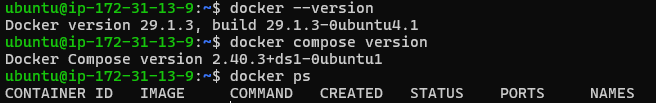 |
| Jenkins running |  |
| Jenkins dashboard |  |
| Node online |  |
| Pipeline configuration |  |
| Stage view (all green) |  |
| Console output success |  |
| Containers healthy |  |
| Running application |  |

## Credits

- Original project and idea: [prashantgohel321](https://github.com/prashantgohel321/DevOps-Project-Two-Tier-Flask-App)
- Updated setup, fixes and documentation: [ChrismPereira](https://github.com/ChrismPereira)
